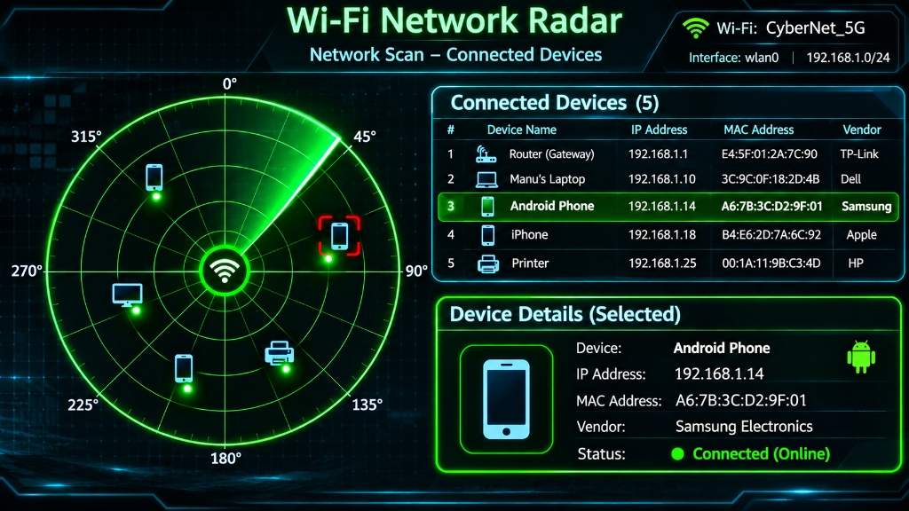

📡 Wi-Fi Network Radar (Kali Linux Edition)
A futuristic tactical cyber HUD Wi-Fi network scanner designed for Kali Linux. Scans the wireless and local network for all connected devices, renders a real-time 60FPS rotating radar animation with glowing device blips, automatically assigns icons based on device type and hardware MAC vendor, and allows full user customization to rename devices and change icons.

---
✨ Features
🎯 Tactical Circular Radar Animation:
Concentric distance/signal rings (25%, 50%, 75%, 100%) and 8-point compass angle markings (0°, 45°, 90°, 135°, 180°, 225°, 270°, 315°).
Continuous 360° sweeping beam with phosphor fading trail.
Glowing green blips positioned at consistent spatial angles based on IP and MAC signatures.
Active sonar blip ping when beam sweeps over devices with synthesized sci-fi audio effects.
Animated red corner-bracket targeting reticle (`[ 📱 ]`) locking onto the currently selected device.
📊 Connected Devices Table:
Live table displaying `#`, `Device Name`, `IP Address`, `MAC Address`, and `Vendor`.
Neon green row highlight indicating the currently selected target device.
Export discovered devices to CSV or JSON with one click.
🔍 Selected Device Details Panel:
Large glowing neon frame showcasing high-res vector silhouette of the selected device.
Detailed telemetry: Device Name, IP, MAC, Manufacturer / Vendor, and real-time Connection Status (`● Connected (Online)`).
Brand & OS badge (Android bugdroid, Apple, Dell, HP, TP-Link, Linux Tux, Windows).
✏️ Device Identification & Icon Customization:
Click "Edit Device" on any target or row.
Customize Device Name / Alias (e.g., "Manu's Laptop", "Living Room TV", "Bob's Phone").
Choose from 14 category icons:
📱 Android Phone
🍎 iPhone / iOS
💻 Laptop
🖥️ Desktop PC
🌐 Router / Gateway
🖨️ Printer
📱 Tablet / iPad
📺 Smart TV
🎮 Gaming Console (PlayStation, Xbox, Switch)
📹 Security Camera
💡 Smart Home / IoT Device
⌚ Smartwatch
🔊 Smart Speaker
🗄️ Server / NAS
Custom user identities are automatically saved to `device_overrides.json` and remembered permanently across scans!
🧪 Deauthentication Testing Module (Safe Simulation):
Dedicated testing panel positioned below selected device details.
Dynamic target validation: testing controls are strictly enabled only when a target device is selected.
Scrollable duration options: 10s, 20s, 30s, 45s, 1 min, 2 min, 5 min, 10 min, 15 min, 30 min.
Prominent red Start Test button and responsive Stop Test button.
Real-time countdown timer (`MM:SS`), animated progress bar, and simulated frame telemetry.
Status cycle: `Idle` ➔ `Running` ➔ `Completed` / `Stopped`.
Non-destructive diagnostic simulation mode (does not transmit disruptive wireless frames).
🛡️ Defensive 802.11 Monitoring (Real Deauth & Disassoc IDS):
Passive, read-only capture: puts the adapter into monitor mode and parses real 802.11 management frames with `tshark` — it never transmits deauth/disassoc frames itself.
Live capability check reports honestly whether monitoring can run right now (root, adapter, and `tshark`/`airmon-ng` all required) and says exactly what's missing if not.
Start Monitoring / Stop Monitoring control begins and ends the real capture; the adapter is automatically restored afterward.
Live log table showing Timestamp, Event Type, Source MAC, Target MAC, and 802.11 Reason Code for every detected frame.
Entries generated by the (simulation-only) Deauthentication Testing module are clearly tagged `(SIM)` so they can never be mistaken for a real detected attack.
Audit log export to CSV and log clearing controls.
⚡ Zero External Pip Dependencies:
Written in Python 3 using only the standard library (`http.server`, `socketserver`, `json`, `subprocess`).
No `pip install` issues on modern Debian / Kali Bookworm systems (no PEP 668 conflicts).
Built-in offline IEEE OUI vendor database for fast manufacturer identification without internet access.
> **Defensive Monitoring requirements:** real deauth/disassoc detection needs `sudo` (monitor mode requires root), a Wi-Fi adapter whose driver supports monitor mode, and the `tshark` package. Install with `sudo apt install -y tshark aircrack-ng`. Without these, the dashboard still runs normally — the monitoring panel just reports that it's unavailable and why, rather than showing fake data.
---
🚀 Quick Start on Kali Linux
1. Transfer or Navigate to the Folder
If running directly on Kali or through a shared folder:
```bash
cd /path/to/kali
```
(On Windows host: `C:\Users\123ma\Documents\kali`)
2. Make the Shell Script Executable
```bash
chmod +x wifi_radar.sh
```
3. Launch the Radar Scanner
```bash
sudo ./wifi_radar.sh
```
Note: Root privileges (`sudo`) are recommended so that `arp-scan` and raw socket ping sweeps can scan the subnet.
4. Automatic HUD Launch
The script will automatically detect your active wireless interface (`wlan0`, `wlan1`, etc.) or Ethernet interface, start the radar server at `http://127.0.0.1:8888`, and launch Chromium / Firefox in app mode.
---
🎛️ Controls & Shortcuts
Control	Description
SCAN NETWORK	Triggers an immediate ARP & ping sweep on the subnet.
AUTO-SCAN (15s)	Toggles continuous background polling every 15 seconds.
AUDIO PING	Toggles futuristic sonar sweep audio sound effects.
DEMO / LIVE	Toggles between sample demo devices and active physical network scan.
EDIT DEVICE	Opens the customization modal to rename the target or switch its icon.
START TEST	Initiates the safe deauthentication testing simulation for the selected duration.
STOP TEST	Aborts an active test simulation and registers the event.
CLEAR LOG	Clears the defensive 802.11 management frame detection event table.
CSV / JSON	Downloads the network inventory or defensive event logs.
---
📁 File Structure
```
kali/
├── wifi_radar.sh             # Main Kali Linux launcher bash script
├── wifi_radar.py             # Python backend server (standard library only)
├── device_overrides.json     # Permanent storage for custom names and icons
├── web/
│   ├── index.html            # Futuristic tactical HUD layout
│   ├── style.css             # Cyberpunk glowing neon styling and animations
│   └── app.js                # 60FPS Canvas radar sweep, blips, targeting reticle & audio
└── README.md                 # Documentation and setup instructions
```
---
🛠️ Custom Device Identity Persistence
Whenever you edit a device in the interface, it writes to `device_overrides.json`:
```json
{
  "A6:7B:3C:D2:9F:01": {
    "name": "Android Phone",
    "icon": "android",
    "notes": "Personal mobile device"
  }
}
```
Whenever that MAC address appears on any future scan, its custom name and icon are automatically applied!
